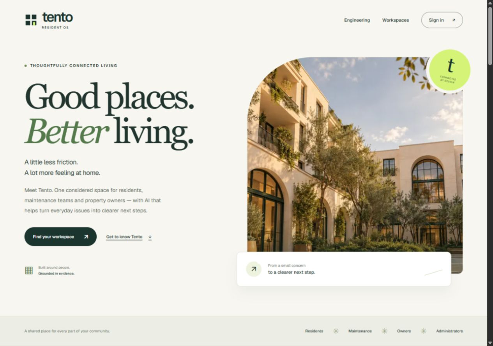

# vishal[in] studio: LinkedIn x YouTube portfolio

A portfolio that looks like a YouTube channel and reads like a LinkedIn profile, in LinkedIn blue with a Gen-Z sticker layer on top. Built with Next.js 14 (App Router), Tailwind CSS, Framer Motion and Lucide icons.

**Live:** https://vishalgwu.github.io/vishal-portfolio/

## What's inside

- **Channel header (LinkedIn profile):** banner with draggable stickers, ringed avatar, headline, Connect / Message / Follow.
- **YouTube chrome:** top bar with search, collapsible sidebar, mobile bottom nav, channel tabs (Home, Projects, Shorts, Playlists, Posts, About), light and dark theme.
- **Projects are videos:** thumbnails with a stat badge, hover previews that cycle the project's metrics, topic chips, sorting.
- **Watch page:** an auto-playing walkthrough with a chaptered scrubber (Overview, Metrics, Architecture, Challenges, Tech stack), keyboard controls, challenges as pinned comments and an Up next rail.
- **Shorts:** vertical cards, one key number each.
- **Playlists:** the five themed categories as stacked playlists.
- **Posts:** a LinkedIn-style feed of experience, research and project drops with Like / Comment / Repost / Send.
- **Recruiter 60-Second Snapshot:** drawer with competencies, metrics, architecture mastery, background and contact.
- Printable `/resume`.

## Featured project: Tento Resident OS

[Live application](https://tento-resident-os.vercel.app/) · [Source code](https://github.com/vishalgwu/tento-agents) · [Engineering showcase](https://tento-resident-os.vercel.app/#engineering)

A deployed GenAI maintenance platform built with Next.js, FastAPI, GPT-4.1-mini, LangGraph, Supabase and Upstash. Four role-based workspaces connect resident reporting to typed agent assessments, tenant-scoped policy retrieval and durable job processing. The project includes 339 passing Python tests, PostgreSQL integration checks and automated web contract checks.



## Data

All 31 projects live in [`data/projects.json`](data/projects.json), audited from the public repositories of [@vishalgwu](https://github.com/vishalgwu). Every metric is copied from the project's own README. Figures a README labels as targets or provisional (for example GuardMem's AUROC) are labelled that way here too. To add a project, append an object with the same shape and list the row ids it belongs to in `categories`.

## Develop

```bash
npm install
npm run dev      # http://localhost:3000
npm run lint
npm run build    # static export to ./out
```

The site is a static export. When served from a sub-path (GitHub Pages), set `NEXT_PUBLIC_BASE_PATH=/vishal-portfolio` before building; the included workflow does this on every push to `main`.

## Layout

```
app/               layout, home page, /resume
components/        Header, Sidebar, ChannelHeader, VideoCard, Thumb, Watch, RecruiterMode, tabs/
data/projects.json audited project dataset
lib/               types, data helpers, profile, cn()
```
